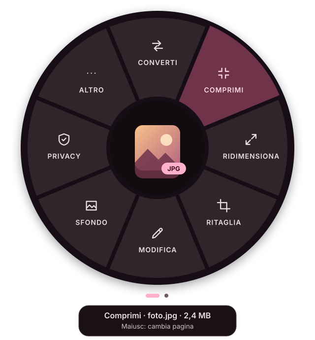
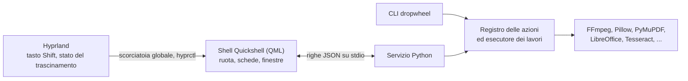

<p align="center">
  
</p>

<h1 align="center">Dropwheel</h1>

<p align="center">
  <b>Una ruota radiale di azioni sui file per il tuo desktop Linux.</b><br>
  Trascina dei file, tocca <kbd>Shift</kbd>, rilascia su un settore: convertiti, compressi, ritagliati, oscurati, condivisi.
</p>

<p align="center">
  
  
  
  
  
  <a href="LICENSE"></a>
</p>

<p align="center">
  <a href="README.md">English</a> · <b>Italiano</b>
</p>

---

Dropwheel porta su Linux l'idea di [Tangerine](https://tangerineformac.com) per macOS. Mentre trascini
dei file da qualsiasi applicazione, tocca <kbd>Shift</kbd>: sotto il puntatore compare una ruota con le
azioni adatte a quei file. Rilasciali su un settore e il lavoro parte. Una piccola scheda nell'angolo
dello schermo mostra l'avanzamento e poi il risultato, che puoi aprire, mostrare nella cartella, copiare,
annullare o trascinare direttamente in un'altra applicazione.

Tutto avviene **sul tuo computer**, con programmi liberi che probabilmente hai già, come FFmpeg,
Ghostscript, LibreOffice e Tesseract. Niente account, niente servizi cloud e niente telemetria.

<p align="center">
  
  <br><sub>Illustrazione della ruota per un file immagine. I colori seguono il tuo tema Caelestia.</sub>
</p>

> [!IMPORTANT]
> **Al momento Dropwheel funziona solo su Arch Linux con Hyprland.** L'obiettivo è estenderlo ad altri
> sistemi operativi: vedi [Piattaforme supportate](#piattaforme-supportate).
>
> Questa è una versione iniziale. Il codice ha un'ampia suite di test automatici, ma il flusso completo di
> trascinamento non è ancora stato provato su una vera sessione Hyprland, e molte parti che chiamano
> programmi esterni sono state eseguite solo con simulazioni. Aspettati qualche imperfezione e, quando ne
> trovi una, [apri una segnalazione](https://github.com/haxurus/dropwheel/issues).

## Indice

- [Punti di forza](#punti-di-forza)
- [Piattaforme supportate](#piattaforme-supportate)
- [Per iniziare](#per-iniziare)
- [Come si usa](#come-si-usa)
- [Cosa può fare](#cosa-può-fare)
- [Dipendenze facoltative](#dipendenze-facoltative)
- [Configurazione](#configurazione)
- [Integrazione con i file manager](#integrazione-con-i-file-manager)
- [Riga di comando](#riga-di-comando)
- [Risoluzione dei problemi](#risoluzione-dei-problemi)
- [Privacy e sicurezza](#privacy-e-sicurezza)
- [Architettura](#architettura)
- [Sviluppo](#sviluppo)
- [Disinstallazione](#disinstallazione)
- [Crediti e licenza](#crediti-e-licenza)

## Punti di forza

- **448 azioni, scelte in base al tipo di file.** Immagini, PDF, documenti Office, Markdown, codice, file
  di dati, ebook, sottotitoli, audio, video, archivi, font, cartelle, link, AppImage e immagini disco.
- **Solo ciò che ha senso.** A un PDF non viene proposto «Converti in PDF». Selezionando più file compaiono
  le azioni di gruppo, come unire dei PDF o trasformare delle immagini in una presentazione.
- **I tuoi originali sono al sicuro.** Gli strumenti scrivono un nuovo file accanto all'originale e non
  sovrascrivono mai un file esistente. Le sole azioni che toccano il file di partenza sono quelle che lo
  dichiarano, come Rinomina, Sposta e Cestino. **Annulla** manda nel cestino i risultati di un lavoro.
- **Oscuramento vero.** L'oscuramento dei PDF rimuove il testo e le immagini sottostanti, poi rilegge il
  risultato per verificare che siano spariti.
- **Editor dove servono.** Ritaglio, oscuramento, taglio, organizzatore di pagine PDF, metadati,
  regolazione dei colori e composizione dello sfondo, tutti con anteprima.
- **Errori chiari.** Una funzione a cui manca il programma appare in grigio e mostra il comando esatto per
  installarlo. Un file che non riesce non ferma mai il resto del gruppo.
- **A casa su Caelestia.** Colori, trasparenza e movimenti seguono il tuo tema. Funziona anche senza
  Caelestia, con una tavolozza scura Material 3.
- **Programmabile.** Le stesse azioni sono disponibili dalla riga di comando, con output JSON.
- **Bilingue.** L'interfaccia è disponibile in italiano e in inglese.

## Piattaforme supportate

| Piattaforma | Stato |
|---|---|
| Arch Linux, Hyprland 0.57+, Caelestia | **Obiettivo principale** |
| Arch Linux, Hyprland 0.57+, senza Caelestia | **Supportata**, con una tavolozza scura integrata |
| Distribuzioni basate su Arch | Dovrebbero funzionare con gli stessi pacchetti, non provate |
| Altre distribuzioni Linux | Non ancora |
| Altri compositor Wayland, X11 | Non ancora |
| Windows, macOS | Non ancora |

### Dove stiamo andando

Arch e Hyprland sono il punto di partenza del progetto, non quello di arrivo. **L'obiettivo è estendere
Dropwheel ad altri sistemi operativi.** Non c'è ancora un calendario, e l'ordine dipenderà da ciò che serve
alle persone e da chi vorrà dare una mano.

L'architettura mantiene portabile la maggior parte del lavoro difficile, perché l'interfaccia parla con il
motore attraverso un piccolo protocollo JSON:

| Livello | Oggi | Cosa serve per portarlo altrove |
|---|---|---|
| Motore delle azioni (Python) | Scritto per Linux, in gran parte indipendente dalla piattaforma | Codice specifico per percorsi, cestino, appunti e notifiche; le tabelle delle dipendenze indicano pacchetti Arch |
| Protocollo | Righe JSON su stdio | Niente: qualsiasi interfaccia può parlarlo |
| Riga di comando | Non richiede un compositor | Quasi niente: un primo passo naturale su una nuova piattaforma |
| Attivazione | Scorciatoie globali di Hyprland e `hyprctl` | Un nuovo modo di rilevare Shift durante un trascinamento su ogni piattaforma |
| Ruota e finestre | Quickshell, Wayland layer-shell | Altri compositor Wayland potrebbero riutilizzarle; gli altri sistemi richiedono una nuova interfaccia |
| Pacchetti | `PKGBUILD`, `install.sh` | Pacchetti nativi per ogni sistema |

Se vorresti Dropwheel sul tuo sistema, una
[segnalazione](https://github.com/haxurus/dropwheel/issues) che descrive la tua configurazione è un utile
punto di partenza.

## Per iniziare

**Requisiti**

| | |
|---|---|
| **Sistema** | Arch Linux o una derivata, su Wayland |
| **Hyprland** | 0.57 o successivo, con configurazione Lua |
| **Quickshell** | 0.3.2 o successivo (`quickshell` o `quickshell-git`) |
| **Python** | 3.11 o successivo, con Pillow |
| **Altri pacchetti** | `wl-clipboard`, `libnotify`, `ttf-material-symbols-variable`, `glib2`, `xdg-utils` |
| **Caelestia** | Consigliato, non obbligatorio |

**Installa come pacchetto Arch (consigliato)**

```sh
git clone https://github.com/haxurus/dropwheel.git
cd dropwheel
makepkg -si
```

Il `PKGBUILD` costruisce il pacchetto dalla cartella in cui ti trovi e pacman tiene traccia di ogni file.

**Oppure installa nella tua home, senza root**

```sh
git clone https://github.com/haxurus/dropwheel.git
cd dropwheel
./install.sh
```

Lo script installa in `~/.local`, controlla le dipendenze e stampa il comando per ciò che manca. Non esegue
mai `sudo`. Le opzioni sono in `./install.sh --help`.

**Poi, con il tuo utente normale, collegalo a Hyprland**

```sh
dropwheel setup hyprland   # Shift, SUPER+ALT+D, regole dei layer e avvio automatico
hyprctl reload
dropwheel start            # dal prossimo login parte da solo
dropwheel doctor           # mostra cosa è installato e cosa manca
```

Ora inizia a trascinare un file e tocca <kbd>Shift</kbd>.

<details>
<summary><b>Cosa cambia <code>dropwheel setup hyprland</code></b></summary>

<br>

Con Caelestia copia il modulo Lua in `~/.config/caelestia/dropwheel.lua` e, dopo averne fatto un backup,
aggiunge una riga a `~/.config/caelestia/hypr-user.lua`:

```lua
require("dropwheel")
```

Il modulo registra:

| Cosa | Dettagli |
|---|---|
| `Shift_L`, `Shift_R` | `hl.dsp.global("dropwheel:shift")`, `non_consuming` perché le applicazioni ricevano comunque Shift, `ignore_mods` perché funzioni anche tenendo Ctrl o Alt |
| `SUPER + ALT + D` | `hl.dsp.global("dropwheel:open")`, apre la ruota con i file negli appunti |
| Regole dei layer | Sfocatura e nessuna animazione di Hyprland su `dropwheel-wheel` e `dropwheel-hud`; nessuna animazione su `dropwheel-dialog` e `dropwheel-hotzone` |
| Avvio automatico | `hl.on("hyprland.start", ...)` esegue `dropwheel start` |

Le opzioni sono in cima al file copiato: la scorciatoia di apertura, i tasti Shift, l'avvio automatico e la
sfocatura.

Senza Caelestia, copia il modulo in `~/.config/hypr/` e aggiungi a `~/.config/hypr/hyprland.lua`:

```lua
package.path = package.path .. ";" .. os.getenv("HOME") .. "/.config/hypr/?.lua"
require("dropwheel")
```

</details>

**Aggiornare**

```sh
git pull
makepkg -sif               # oppure: ./install.sh
dropwheel stop && dropwheel start
```

La `f` è importante: la versione non cambia a ogni commit, quindi senza di essa makepkg reinstalla il
pacchetto costruito la volta precedente.

## Come si usa

Ci sono cinque modi per aprire la ruota.

1. **Shift durante un trascinamento.** Inizia a trascinare, tocca <kbd>Shift</kbd>, spostati su un settore
   e rilascia. È il modo principale. Dropwheel controlla che un trascinamento sia davvero in corso, quindi
   Shift continua a funzionare normalmente mentre scrivi.
2. **L'angolo attivo.** Trascina i file sull'area di 6×6 pixel nell'angolo in alto a destra dello schermo.
   Angolo, dimensione e presenza stessa sono configurabili.
3. **SUPER+ALT+D.** Copia dei file nel file manager e premi la scorciatoia. Se negli appunti non c'è nulla,
   ottieni un'area vuota su cui trascinare i file.
4. **Il file manager.** Fai clic destro sui file e scegli **Apri in Dropwheel**.
5. **Il terminale.** Esegui `dropwheel open foto.heic`.

**Durante un trascinamento**

| Gesto | Effetto |
|---|---|
| Tocca <kbd>Shift</kbd> | Apre la ruota; se è già aperta, passa dalla pagina **Strumenti** alla pagina **File** e viceversa |
| Resta su un gruppo per 450 ms | Apre l'anello di quel gruppo |
| Resta al centro per 450 ms | Torna all'anello precedente |
| Rilascia su un'azione | La esegue, oppure apre il suo editor |
| Rilascia su un gruppo | Lascia la ruota aperta su quell'anello, in modalità clic |
| Rilascia al centro o fuori | Annulla |
| <kbd>Esc</kbd> | Annulla il trascinamento e chiude la ruota |

**In modalità clic** (dopo SUPER+ALT+D, l'angolo attivo, il file manager o un rilascio su un gruppo)

| Tasto o gesto | Effetto |
|---|---|
| Frecce, <kbd>Tab</kbd>, rotellina | Spostano l'evidenziazione |
| Da <kbd>1</kbd> a <kbd>8</kbd> | Esegue il settore N, in senso orario da mezzogiorno |
| <kbd>Invio</kbd> o clic | Esegue l'azione o apre il gruppo |
| <kbd>Alt</kbd>+<kbd>Invio</kbd> o clic destro | Imposta prima i parametri di un'azione rapida |
| <kbd>Backspace</kbd> o clic al centro | Torna indietro |
| <kbd>Esc</kbd> | Torna indietro; sull'anello principale, chiude |
| <kbd>Shift</kbd> o <kbd>Ctrl</kbd>+<kbd>Tab</kbd> | Cambia pagina |

**Schede dei lavori**

Dopo il rilascio compare una scheda nell'angolo in basso a destra. Durante il lavoro mostra l'avanzamento e
un pulsante per interrompere. Alla fine mostra un'anteprima, lo spazio risparmiato e i pulsanti **Apri**,
**Mostra nella cartella**, **Copia** e **Annulla**. Puoi anche **trascinare il risultato** direttamente in
un browser, una chat o un'e-mail. I lavori non riusciti restano finché non li chiudi, con i dettagli e, se
manca un programma, un pulsante che copia il comando di installazione.

## Cosa può fare

L'anello si adatta al file, quindi le voci esatte possono cambiare. Gli anelli hanno al massimo otto
settori, e le voci in più passano in **Altro**.

| Tipo di file | Azioni |
|---|---|
| **Immagini** (JPG, PNG, WebP, AVIF, HEIC, JPEG XL, TIFF, BMP, ICO, PSD) | Converti, comprimi (anche a una dimensione precisa), ridimensiona (con formati per i social), ritaglia, ruota, rifletti, regola i colori, annota, filigrana, rimuovi o aggiungi uno sfondo, togli la posizione o tutti i metadati, oscura, OCR, leggi i codici QR, ingrandisci con l'AI, vettorizza, crea icone, imposta come sfondo, stampa |
| **Immagini animate** (GIF, WebP, APNG) | Converti in MP4 o WebM, comprimi, ridimensiona, ritaglia, ruota, estrai i fotogrammi, al contrario, cambia la velocità |
| **SVG** | Converti in PNG, PDF, JPG, WebP o ICO, ottimizza, copia come testo o immagine, crea icone |
| **PDF** | Converti in DOCX, JPG, PNG, TXT, Markdown, EPUB, HTML o PDF/A; comprimi; organizza, dividi, estrai, elimina e ruota le pagine; proteggi con AES-256 o sblocca; oscuramento vero; modifica i metadati; OCR; estrai immagini e allegati; annota; filigrana; numeri di pagina; appiattisci; ripara |
| **Documenti** (DOCX, DOC, ODT, RTF) | Converti in PDF, ODT, Markdown, TXT, HTML, EPUB o RTF, comprimi le immagini incluse, rimuovi i dati personali, estrai immagini e testo, PDF protetto da password, statistiche |
| **Fogli di calcolo** (XLSX, ODS, XLS, CSV, TSV) | Converti in ODS, CSV, PDF, JSON, tabella Markdown, HTML o TSV, rimuovi i metadati, informazioni sul foglio |
| **Presentazioni** (PPTX, ODP, PPT) | Converti in PDF, ODP o immagini, comprimi i media, estrai testo, note del relatore e immagini, rimuovi i metadati |
| **Markdown** | Converti in PDF, HTML, DOCX, ODT, EPUB, TXT o RTF, diapositive, indice, formattazione, statistiche |
| **Testo e codice** | Esporta in PDF, HTML, DOCX o Markdown con evidenziazione della sintassi, converti in UTF-8, correggi i fine riga, togli gli spazi finali, statistiche |
| **Dati** (JSON, YAML, TOML, XML) | Converti tra i formati e in CSV o XLSX, formatta, minimizza, verifica, ordina le chiavi |
| **Ebook** (EPUB, MOBI, AZW3, FB2, CBZ) | Converti, estrai la copertina, informazioni sul libro |
| **Sottotitoli** (SRT, VTT, ASS) | Converti, sposta i tempi, cambia gli fps, togli i tag per non udenti, testo semplice |
| **Audio** (MP3, M4A, FLAC, WAV, Opus, OGG) | Converti, comprimi, taglia, normalizza secondo EBU R128, modifica tag e copertina, trascrivi in locale con whisper.cpp, cambia la velocità, dissolvenza, togli i silenzi, riduci il rumore, video con la forma d'onda |
| **Video** (MP4, MKV, WebM, MOV, AVI) | Converti, comprimi (anche per WhatsApp/Telegram e a una dimensione precisa), taglia, ritaglia, ridimensiona, togli l'audio, ruota, cambia la velocità, al contrario, ripeti, stabilizza, estrai audio, fotogrammi e sottotitoli, foglio provini, genera o imprimi i sottotitoli, dividi, modifica i metadati |
| **Archivi** (ZIP, 7Z, RAR, TAR, GZ, XZ, ZST) | Estrazione intelligente, estrai in una cartella, elenca, verifica, converti, aggiungi una password |
| **Font** (TTF, OTF, WOFF, WOFF2) | Installa, foglio di anteprima, converti, kit per il web, sottoinsieme, informazioni |
| **Cartelle** | Comprimi, rinomina in blocco, dimensioni, trova i duplicati, crea SHA256SUMS, elenca il contenuto, appiattisci |
| **Link** | Scarica, salva video o audio con yt-dlp, codice QR, copia il link pulito, salva la pagina in PDF, crea un collegamento |
| **AppImage, immagini disco, pacchetti** | Aggiungi al menu, avvia, monta in sola lettura, verifica, ispeziona, estrai |
| **File sconosciuti** | Identifica il tipo reale, checksum, vista esadecimale, stringhe, cifra |

Ogni file ha anche una pagina **File**: copia, copia il percorso, sposta, rinomina, duplica, ZIP, apri con,
condividi (codice QR per il telefono, KDE Connect, LocalSend, e-mail), proprietà, checksum, cifra con
GnuPG, apri un terminale qui e cestino.

**Più file insieme.** I file dello stesso tipo hanno azioni di gruppo, per esempio immagini in PDF, GIF,
presentazione o collage; unione di PDF, video o audio; documenti in un unico PDF. Le selezioni miste
ricevono ciò che vale per tutti.

**Dove finiscono i risultati**

| Operazione | Esempio |
|---|---|
| Conversione | `foto.heic` produce `foto.jpg` |
| Strumento sullo stesso formato | `foto.jpg` produce `foto (compresso).jpg` |
| Nome già esistente | `foto 2.jpg`, `foto 3.jpg` e così via, mai una sovrascrittura |
| Più file in uscita | Una cartella come `documento (pagine)/` |
| Origine in sola lettura o temporanea | `~/Scaricati/Dropwheel`, e la scheda te lo dice |

L'elenco completo delle azioni, anello per anello e con i programmi che richiedono, è in
[docs/FUNCTIONS.it.md](docs/FUNCTIONS.it.md).

## Dipendenze facoltative

Solo i [requisiti](#per-iniziare) sono obbligatori. Tutto il resto abilita singole funzioni, e
`dropwheel doctor` mostra cosa manca. Dropwheel non esegue mai `sudo` al posto tuo.

Una buona base che copre la maggior parte delle funzioni:

```sh
sudo pacman -S --needed python-pillow-heif python-pillow-jpegxl-plugin oxipng pngquant jpegoptim \
    gifski perl-image-exiftool tesseract tesseract-data-ita tesseract-data-eng zbar python-qrcode \
    python-pymupdf python-pypdf qpdf ghostscript poppler libreoffice-fresh pandoc-cli typst \
    ffmpeg python-mutagen 7zip python-fonttools python-brotli
```

<details>
<summary><b>Elenco completo per funzione</b></summary>

<br>

**Repository ufficiali**

| Funzione | Pacchetti |
|---|---|
| HEIC e JPEG XL | `python-pillow-heif python-pillow-jpegxl-plugin` |
| Ottimizzazione delle immagini | `oxipng pngquant jpegoptim libjpeg-turbo` |
| GIF e animazioni | `gifski gifsicle libwebp-utils` |
| Formati insoliti, immagini enormi | `imagemagick libheif libvips` |
| SVG | `librsvg resvg potrace inkscape scour` o `svgo` |
| Metadati e privacy | `perl-image-exiftool mat2` |
| OCR | `tesseract tesseract-data-ita tesseract-data-eng`, più le tue lingue |
| Codici QR e a barre | `zbar python-qrcode qrencode` |
| Annotazioni | `satty` o `swappy`, `xournalpp` per i PDF |
| Ingrandimento con l'AI | `waifu2x-ncnn-vulkan` |
| PDF | `python-pymupdf python-pypdf python-pikepdf python-cryptography qpdf ghostscript poppler mupdf-tools img2pdf` |
| Documenti Office | `libreoffice-fresh` o `libreoffice-still`, `python-openpyxl python-docx` |
| Markdown, testo, codice | `pandoc-cli typst python-weasyprint python-pygments python-charset-normalizer` |
| Dati strutturati | `python-yaml python-tomli-w python-defusedxml` |
| Ebook | `calibre` |
| Audio e video | `ffmpeg python-mutagen` |
| Trascrizione e sottotitoli | `whisper-cpp` |
| Download dai link | `yt-dlp deno` |
| Archivi | `7zip unrar unarchiver` |
| Font | `python-fonttools python-brotli` |
| AppImage | `squashfs-tools` |
| Invio al telefono | `kdeconnect` |
| Sistema | `gnupg udisks2 trash-cli zenity gtk3 xdg-terminal-exec` |
| Selettore colore nelle finestre | `hyprpicker` |
| Stampa | `cups` |
| Checksum XXH128 | `xxhash` |
| Pagina web in PDF | `chromium` o un altro browser basato su Chromium |

**AUR**

| Pacchetto | Scopo |
|---|---|
| `ocrmypdf` | Rendere ricercabili i PDF scansionati |
| `python-pdf2docx` | Conversione da PDF a Word più fedele |
| `vtracer` | Vettorializzazione a colori |
| `realesrgan-ncnn-vulkan-bin` | Ingrandimento ×4 con Real-ESRGAN |
| `localsend-cli-bin` | Invio con LocalSend |

**pipx**

| Comando | Scopo |
|---|---|
| `pipx install "rembg[cpu,cli]"` | Rimozione dello sfondo; al primo uso scarica un modello AI |

</details>

## Configurazione

Non serve alcuna configurazione. Per partire da un file commentato in `~/.config/dropwheel/config.toml`:

```sh
dropwheel config --init
```

Le modifiche valgono alla successiva apertura della ruota. Un valore non valido torna a quello predefinito
con un avviso e non blocca mai nulla. Per esempio:

```toml
language = "it"                     # auto | it | en
hidden_actions = ["image.background.*"]

[output]
location = "source"                 # accanto all'originale; "folder" = sempre la cartella qui sotto
folder = "~/Scaricati/Dropwheel"

[hotzone]
corner = "bottom-left"

[image]
jpeg_quality = 82

# Le tue azioni, mostrate nella ruota accanto a quelle integrate
[[custom]]
id = "immagine-blog"
label = "Per il blog"
icon = "web"
categories = ["image"]
command = "magick {file} -resize '1600x1600>' -quality 80 {dir}/{stem}-blog.jpg"
output = "files"
```

Tutte le chiavi, con esempi di azioni personalizzate, sono in [docs/CONFIG.it.md](docs/CONFIG.it.md).

## Integrazione con i file manager

| File manager | Come | Nel menu |
|---|---|---|
| **Thunar** (predefinito in Caelestia) | `dropwheel setup thunar --apply` | Apri in Dropwheel |
| **Nautilus** | `dropwheel setup nautilus` | Script, poi Dropwheel |
| **Dolphin** | Incluso nel pacchetto, oppure `dropwheel setup dolphin` | Apri in Dropwheel |
| **Nemo** | Incluso nel pacchetto, oppure `dropwheel setup nemo` | Apri in Dropwheel |

Caelestia gestisce il file `uca.xml` di Thunar, quindi Dropwheel lo modifica solo se passi `--apply`, e prima
ne fa un backup. I passaggi manuali sono in [integrations/thunar/README.md](integrations/thunar/README.md).

## Riga di comando

```sh
dropwheel open ~/Immagini/foto.heic              # la ruota, in modalità clic
dropwheel menu --json documento.pdf              # le azioni disponibili, in JSON
dropwheel run image.compress.balanced foto.jpg   # esegue un'azione senza interfaccia
```

| Comando | Descrizione |
|---|---|
| `dropwheel start`, `stop`, `restart`, `status` | Controllano la shell e il servizio in background |
| `dropwheel open [FILE...]` | Apre la ruota per file o URL; senza argomenti usa gli appunti |
| `dropwheel menu FILE... [--json]` | Mostra le azioni disponibili per i file |
| `dropwheel actions [-c CATEGORIA] [--json]` | Elenca tutte le azioni e se sono disponibili |
| `dropwheel run AZIONE FILE... [-p CHIAVE=VALORE]... [--json]` | Esegue un'azione; l'id di un gruppo esegue la sua predefinita |
| `dropwheel undo [LAVORO]`, `history [-n N]` | Annulla un lavoro (di norma l'ultimo), mostra i lavori recenti |
| `dropwheel doctor [--json] [--full]` | Controlla Hyprland, Quickshell e gli strumenti, con i comandi di installazione |
| `dropwheel setup hyprland\|nautilus\|dolphin\|nemo\|thunar\|desktop\|all` | Installa un'integrazione |
| `dropwheel shares [--stop ID\|--stop-all]` | Elenca o interrompe le condivisioni attive in rete locale |
| `dropwheel config [--path\|--init\|--edit]` | Mostra, crea o modifica la configurazione |

I codici di uscita sono `0` per il successo, `1` per un errore, `2` per un uso sbagliato e `130` per
un'interruzione. `dropwheel setup` non sovrascrive mai un file senza prima salvarne una copia chiamata
`<file>.dropwheel-bak-AAAAMMGG-HHMMSS`.

| Variabile d'ambiente | Effetto |
|---|---|
| `DROPWHEEL_CONFIG` | Percorso alternativo di `config.toml` |
| `DROPWHEEL_DATA` | Cartella dei dati con la shell e le integrazioni, di norma `~/.local/share/dropwheel` o `/usr/share/dropwheel` |
| `DROPWHEEL_BACKEND` | Il comando del servizio usato dalla shell, impostato da `dropwheel start` |

## Risoluzione dei problemi

Inizia sempre con `dropwheel doctor`.

<details>
<summary><b>La ruota non compare quando premo Shift</b></summary>

<br>

1. **È in esecuzione?** `hyprctl globalshortcuts` deve elencare `dropwheel:shift` e `dropwheel:open`. Se
   non li elenca, esegui `dropwheel start` da un terminale e leggi gli eventuali errori.
2. **Le scorciatoie sono caricate?** `hyprctl binds | grep -i -B2 -A8 dropwheel` deve mostrarle. Se non
   compaiono, esegui `dropwheel setup hyprland` e poi `hyprctl reload`.
3. **Compare solo quando rilasci Shift?** È normale se hai scorciatoie che iniziano con Shift, perché
   Hyprland aspetta di capire se stai componendo una combinazione più lunga. Tocca Shift invece di tenerlo
   premuto.
4. **Stai trascinando da un'applicazione XWayland?** Il trascinamento da client X11 verso superfici Wayland
   non funziona in Hyprland 0.57. Controlla con `hyprctl clients` (`xwayland: 1`). Avvia l'applicazione in
   modalità Wayland, oppure copia i file e usa SUPER+ALT+D.
5. **Ancora niente?** Per prova, imposta `dnd_check = false` in `[trigger]` nel file `config.toml`. La ruota
   si apre allora a ogni Shift e si richiude da sola se non arriva nessun trascinamento.

</details>

<details>
<summary><b>Dove trovo i log?</b></summary>

<br>

```sh
qs log -p /usr/share/dropwheel/shell -f            # pacchetto di sistema
qs log -p ~/.local/share/dropwheel/shell -f        # install.sh
```

Il log della shell comprende gli errori del servizio Python. I comandi avviati da Hyprland mandano il loro
output in `/dev/null`, quindi esegui `dropwheel start` da un terminale per vedere gli errori di avvio.

</details>

<details>
<summary><b>Le icone sono quadratini o lettere</b></summary>

<br>

Manca il font delle icone. Esegui `sudo pacman -S ttf-material-symbols-variable`, poi `fc-cache -f` e infine
`dropwheel stop && dropwheel start`.

</details>

<details>
<summary><b>Una funzione è grigia</b></summary>

<br>

Il programma che le serve non è installato. Passa sopra il settore per vedere quale e il comando per
installarlo. Dropwheel ricontrolla ogni dieci minuti, oppure subito dopo `dropwheel stop && dropwheel start`.

</details>

<details>
<summary><b>Il risultato è finito in ~/Scaricati/Dropwheel</b></summary>

<br>

Succede quando l'originale si trova in un punto in sola lettura o temporaneo, come un download del browser in
corso, `/tmp` o un file condiviso da un'app Flatpak. Per usare sempre una sola cartella, imposta
`output.location = "folder"`.

</details>

<details>
<summary><b>Premendo Shift l'applicazione di origine sposta i miei file?</b></summary>

<br>

Hyprland inoltra Shift anche all'applicazione di origine, dove spesso significa «sposta». Dropwheel legge
sempre i file come copia e non li sposta né li cancella al rilascio. Se apri la ruota e poi rilasci in
un'altra applicazione, lascia prima Shift.

</details>

<details>
<summary><b>Il comando <code>dropwheel</code> non esiste</b></summary>

<br>

Con `install.sh` il comando è in `~/.local/bin`, che deve essere nel `PATH`. Su fish, esegui
`fish_add_path ~/.local/bin`. Su bash o zsh, aggiungi `export PATH="$HOME/.local/bin:$PATH"` al file di avvio
della shell. Hyprland e i file manager usano comunque il percorso completo.

</details>

<details>
<summary><b>Ho un file in <code>~/.config/quickshell/shell.qml</code></b></summary>

<br>

Con un `shell.qml` direttamente in `~/.config/quickshell/`, Quickshell non trova più le configurazioni nelle
sottocartelle. Dropwheel **non ne è toccato**, perché viene sempre avviato indicando il percorso. Non spostare
la sua shell in `~/.config/quickshell/`.

</details>

<details>
<summary><b>Le conversioni di documenti non producono nulla</b></summary>

<br>

LibreOffice in modalità invisibile non fa nulla, senza errori, se il suo profilo è già in uso. Dropwheel usa un
**profilo privato**, quindi non ne è toccato, ma la prima conversione è più lenta perché il profilo viene creato.
Se ancora non funziona, `soffice --version` deve rispondere e `dropwheel doctor` deve vedere `soffice`.

</details>

<details>
<summary><b>Alcuni file si aprono con Dropwheel</b></summary>

<br>

La voce di Dropwheel dichiara i tipi di file più comuni per comparire in «Apri con». Se uno di questi tipi non ha
un'applicazione predefinita, un programma potrebbe scegliere Dropwheel. Imposta quella giusta, per esempio:

```sh
xdg-mime default org.gnome.Loupe.desktop image/png
```

`install.sh` lo fa da solo per i tipi che avevano già un'applicazione predefinita.

</details>

<details>
<summary><b>Le azioni dal file manager non fanno nulla</b></summary>

<br>

Prova `dropwheel open ~/un/file.jpg` da un terminale. La comunicazione con la shell funziona solo sullo stesso
display Wayland, quindi il file manager deve avere `WAYLAND_DISPLAY` nel suo ambiente. È normale se è stato
avviato dalla sessione Hyprland.

</details>

<details>
<summary><b>Dropwheel si chiude da solo all'avvio</b></summary>

<br>

Il protocollo delle scorciatoie globali non ammette due client con lo stesso nome, quindi se parte una seconda
copia, una delle due viene chiusa. Controlla con `qs list`, poi esegui `dropwheel stop && dropwheel start`.

</details>

<details>
<summary><b>Un documento viene rifiutato perché troppo grande</b></summary>

<br>

Un documento Office, un EPUB o un CBZ può dichiarare parti enormi in un file minuscolo. Per proteggere la
memoria, Dropwheel non apre parti compresse in modo insolito (bzip2, LZMA) né legge parti di testo oltre i
64 MiB (256 MiB per il contenuto di un foglio ODS). **Comprimi** e **Rimuovi metadati** copiano comunque i video
incorporati, fino a 8 GiB in tutto, ed **Estrai immagini** salta le parti oltre i 64 MiB e dice quali.

</details>

## Privacy e sicurezza

- **Tutto è locale.** Niente telemetria, servizi cloud o account.
- **La rete viene usata solo quando lo chiedi:**
  - *Il codice QR per il telefono* avvia un server HTTP temporaneo nella rete locale, su una porta e un
    indirizzo casuali, che offre solo i file scelti e si spegne dopo 15 minuti o quando chiudi la scheda.
  - *KDE Connect e LocalSend* inviano ai tuoi dispositivi associati.
  - *I link trascinati* vengono scaricati solo dal sito di quel link.
  - *I modelli AI* vengono scaricati solo quando installi o usi per la prima volta la funzione.
- **Nulla di ciò che trascini viene eseguito.** Macro dei documenti e JavaScript dei PDF non partono mai,
  un'AppImage viene ispezionata senza avviarla, e le immagini remote nel Markdown e i riferimenti esterni negli
  SVG non vengono scaricati.
- **I file non fidati sono trattati con prudenza.** Le voci pericolose degli archivi, come percorsi assoluti,
  `..` e link che puntano fuori dall'archivio, vengono rifiutate, e ci sono protezioni contro gli archivi e i
  documenti bomba.
- **Le password** restano in memoria solo per il lavoro che le usa.

Quando oscuri un'immagine, sfocatura e pixel possono essere reversibili sul testo. Per i dati sensibili usa un
riquadro pieno.

## Architettura



- **Shell (`shell/`).** Una configurazione Quickshell avviata indicando il percorso, quindi non interferisce
  mai con la shell di Caelestia.
- **Servizio (`src/dropwheel/daemon.py`).** Risponde a richieste di menu, anteprime e lavori su stdin e stdout.
- **Azioni (`src/dropwheel/actions/`).** Un modulo per famiglia, registrato con un decoratore che dichiara
  categorie, parametri e strumenti richiesti. I menu sono costruiti da queste dichiarazioni.
- **Lavori (`src/dropwheel/jobs.py`).** Parallelismo, interruzione, avanzamento, scrittura atomica, annulla.

[docs/ARCHITECTURE.md](docs/ARCHITECTURE.md) spiega come aggiungere un'azione o una traduzione, e
[docs/SPEC.md](docs/SPEC.md) è il contratto completo. Entrambi sono in inglese.

## Sviluppo

```sh
PYTHONPATH=src python -m dropwheel doctor
PYTHONPATH=src python -m dropwheel start   # usa shell/ e integrations/ di questa cartella
make test                                  # pytest
make lint                                  # Python, script, Lua, XML, voci .desktop, QML
```

I contributi sono benvenuti, e in questo momento sono particolarmente preziose le segnalazioni da vere sessioni
Hyprland. Lo stesso vale per l'aiuto a portare Dropwheel su [altri sistemi](#dove-stiamo-andando).

## Disinstallazione

**Pacchetto di sistema**

```sh
sudo pacman -Rns dropwheel
```

Poi togli la riga `require("dropwheel")` da `~/.config/caelestia/hypr-user.lua`, cancella
`~/.config/caelestia/dropwheel.lua` ed esegui `hyprctl reload`. pacman non tocca la tua home, quindi
impostazioni, cronologia, cache e modelli Whisper restano finché non li cancelli.

**install.sh**

```sh
~/.local/share/dropwheel/uninstall.sh           # conserva impostazioni e dati
~/.local/share/dropwheel/uninstall.sh --purge   # cancella anche quelli, dopo una conferma
```

I file che hai creato con Dropwheel non vengono mai cancellati.

## Crediti e licenza

- L'idea e il flusso d'uso vengono da **[Tangerine](https://tangerineformac.com)** per macOS, con spunti da
  OpenShelf e DragShift. Dropwheel non è affiliato a questi progetti.
- Il linguaggio visivo viene da **[Caelestia](https://github.com/caelestia-dots)**. Dropwheel è costruito con
  **[Hyprland](https://hypr.land)** e **[Quickshell](https://quickshell.org)**, con le icone Material Symbols di
  Google.
- Il vero lavoro lo fa straordinario software libero, tra cui FFmpeg, Pillow, ImageMagick, libvips, PyMuPDF,
  pypdf, qpdf, Ghostscript, Poppler, LibreOffice, pandoc, Typst, Tesseract, OCRmyPDF, whisper.cpp, ExifTool,
  7-Zip, calibre, fontTools e yt-dlp, ciascuno con la propria licenza.

Dropwheel è distribuito con la [licenza MIT](LICENSE).
