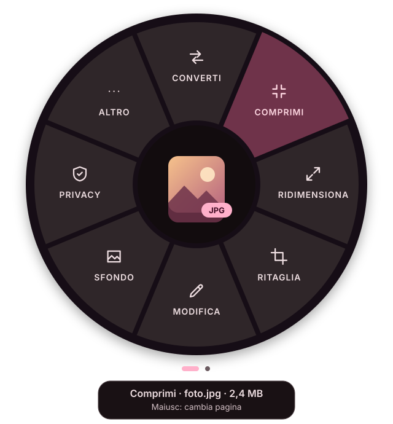

<p align="center">
  
</p>

<h1 align="center">Dropwheel</h1>

<p align="center">
  <b>Una ruota radiale di azioni sui file per il tuo desktop Linux.</b><br>
  Trascina dei file, tocca <kbd>Shift</kbd>, rilascia su un settore: convertiti, compressi, ritagliati, oscurati, condivisi.
</p>

<p align="center">
  
  
  
  
  
  <a href="LICENSE"></a>
</p>

<p align="center">
  <a href="README.md">English</a> · <b>Italiano</b>
</p>

---

Dropwheel porta su Linux l'idea di [Tangerine](https://tangerineformac.com) per macOS. Mentre trascini
dei file da qualsiasi applicazione, tocca <kbd>Shift</kbd>: sotto il puntatore compare una ruota con le
azioni adatte a quei file. Rilasciali su un settore e il lavoro parte. Una piccola scheda nell'angolo
dello schermo mostra l'avanzamento e poi il risultato, che puoi aprire, mostrare nella cartella, copiare,
annullare o trascinare direttamente in un'altra applicazione.

Tutto avviene **sul tuo computer**, con programmi liberi che probabilmente hai già, come FFmpeg,
Ghostscript, LibreOffice e Tesseract. Niente account, niente servizi cloud e niente telemetria.

<p align="center">
  
  <br><sub>Illustrazione della ruota per un file immagine. I colori seguono il tuo tema Caelestia.</sub>
</p>

> [!IMPORTANT]
> **Al momento Dropwheel funziona solo su Arch Linux con Hyprland.** L'obiettivo è estenderlo ad altri
> sistemi operativi: vedi [Piattaforme supportate](#piattaforme-supportate). Una prima anteprima del
> motore e della riga di comando su Windows è descritta in [Dropwheel su Windows](docs/WINDOWS.it.md).
>
> Questa è una versione iniziale. Il codice ha un'ampia suite di test automatici, ma il flusso completo di
> trascinamento non è ancora stato provato su una vera sessione Hyprland, e molte parti che chiamano
> programmi esterni sono state eseguite solo con simulazioni. Aspettati qualche imperfezione e, quando ne
> trovi una, [apri una segnalazione](https://github.com/haxurus/dropwheel/issues).

## Indice

- [Punti di forza](#punti-di-forza)
- [Piattaforme supportate](#piattaforme-supportate)
- [Per iniziare](#per-iniziare)
- [Documentazione](#documentazione)
- [Crediti e licenza](#crediti-e-licenza)

## Punti di forza

- **448 azioni, scelte in base al tipo di file.** Immagini, PDF, documenti Office, Markdown, codice, file
  di dati, ebook, sottotitoli, audio, video, archivi, font, cartelle, link, AppImage e immagini disco.
- **Solo ciò che ha senso.** A un PDF non viene proposto «Converti in PDF». Selezionando più file compaiono
  le azioni di gruppo, come unire dei PDF o trasformare delle immagini in una presentazione.
- **I tuoi originali sono al sicuro.** Gli strumenti scrivono un nuovo file accanto all'originale e non
  sovrascrivono mai un file esistente. Le sole azioni che toccano il file di partenza sono quelle che lo
  dichiarano, come Rinomina, Sposta e Cestino. **Annulla** manda nel cestino i risultati di un lavoro.
- **Oscuramento vero.** L'oscuramento dei PDF rimuove il testo e le immagini sottostanti, poi rilegge il
  risultato per verificare che siano spariti.
- **Editor dove servono.** Ritaglio, oscuramento, taglio, organizzatore di pagine PDF, metadati,
  regolazione dei colori e composizione dello sfondo, tutti con anteprima.
- **Errori chiari.** Una funzione a cui manca il programma appare in grigio e mostra il comando esatto per
  installarlo. Un file che non riesce non ferma mai il resto del gruppo.
- **A casa su Caelestia.** Colori, trasparenza e movimenti seguono il tuo tema. Funziona anche senza
  Caelestia, con una tavolozza scura Material 3.
- **Programmabile.** Le stesse azioni sono disponibili dalla riga di comando, con output JSON.
- **Bilingue.** L'interfaccia è disponibile in italiano e in inglese.

## Piattaforme supportate

| Piattaforma | Stato |
|---|---|
| Arch Linux, Hyprland 0.57+, Caelestia | **Obiettivo principale** |
| Arch Linux, Hyprland 0.57+, senza Caelestia | **Supportata**, con una tavolozza scura integrata |
| Distribuzioni basate su Arch | Dovrebbero funzionare con gli stessi pacchetti, non provate |
| Altre distribuzioni Linux | Non ancora |
| Altri compositor Wayland, X11 | Non ancora |
| Windows 10 e 11 | **Anteprima**: solo il motore e la riga di comando, non ancora provati su un vero Windows. Vedi [Dropwheel su Windows](docs/WINDOWS.it.md) |
| macOS | Non ancora |

### Dove stiamo andando

Arch e Hyprland sono il punto di partenza del progetto, non quello di arrivo. **L'obiettivo è estendere
Dropwheel ad altri sistemi operativi.** Non c'è ancora un calendario, e l'ordine dipenderà da ciò che serve
alle persone e da chi vorrà dare una mano.

L'architettura mantiene portabile la maggior parte del lavoro difficile, perché l'interfaccia parla con il
motore attraverso un piccolo protocollo JSON:

| Livello | Oggi | Cosa serve per portarlo altrove |
|---|---|---|
| Motore delle azioni (Python) | Linux, più i rami Windows in anteprima per percorsi, cestino, appunti, processi e indicazioni di installazione | Le notifiche su Windows; lo stesso lavoro per macOS |
| Protocollo | Righe JSON su stdio | Niente: qualsiasi interfaccia può parlarlo |
| Riga di comando | Non richiede un compositor | Quasi niente: un primo passo naturale su una nuova piattaforma |
| Attivazione | Scorciatoie globali di Hyprland e `hyprctl` | Un nuovo modo di rilevare Shift durante un trascinamento su ogni piattaforma |
| Ruota e finestre | Quickshell, Wayland layer-shell | Altri compositor Wayland potrebbero riutilizzarle; gli altri sistemi richiedono una nuova interfaccia |
| Pacchetti | `PKGBUILD`, `install.sh` | Pacchetti nativi per ogni sistema |

Se vorresti Dropwheel sul tuo sistema, una
[segnalazione](https://github.com/haxurus/dropwheel/issues) che descrive la tua configurazione è un utile
punto di partenza.

## Per iniziare

Su Arch Linux con Hyprland 0.57 o successivo e Quickshell 0.3.2 o successivo:

```sh
git clone https://github.com/haxurus/dropwheel.git
cd dropwheel
makepkg -si                # oppure ./install.sh, senza root, in ~/.local
dropwheel setup hyprland   # Shift, SUPER+ALT+D, regole dei layer e avvio automatico
hyprctl reload
dropwheel start
```

Ora inizia a trascinare un file e tocca <kbd>Shift</kbd>. I requisiti, l'elenco completo dei programmi
facoltativi, l'aggiornamento e la disinstallazione sono nella [guida all'installazione](docs/INSTALL.it.md).

## Documentazione

La documentazione completa è nella cartella [docs](docs/README.it.md).

| Guida | Cosa trovi |
|---|---|
| [Installare](docs/INSTALL.it.md) | Requisiti, pacchetto Arch o `install.sh`, collegamento a Hyprland, programmi facoltativi, aggiornamento, disinstallazione |
| [Usare Dropwheel](docs/USAGE.it.md) | I cinque modi per aprire la ruota, gesti e tasti, schede dei lavori, configurazione, file manager |
| [Cosa può fare](docs/FEATURES.it.md) | Azioni per tipo di file, più file insieme, dove finiscono i risultati |
| [Riga di comando](docs/CLI.it.md) | Ogni comando `dropwheel`, codici di uscita, variabili d'ambiente |
| [Riferimento della configurazione](docs/CONFIG.it.md) | Ogni chiave di `config.toml` e le azioni personalizzate |
| [Riferimento delle funzioni](docs/FUNCTIONS.it.md) | Ogni azione, anello per anello, con i programmi che richiede |
| [Risoluzione dei problemi](docs/TROUBLESHOOTING.it.md) | La ruota non compare, log, icone mancanti, funzioni in grigio |
| [Privacy e sicurezza](docs/PRIVACY.it.md) | Cosa usa la rete e come vengono trattati i file non fidati |
| [Windows](docs/WINDOWS.it.md) | L'anteprima per Windows: cosa funziona, come installarla, cosa manca |
| [Architettura e sviluppo](docs/DEVELOPMENT.it.md) | Come stanno insieme i pezzi, avvio dal sorgente, test |
| [Registro delle modifiche](CHANGELOG.it.md) | Cosa è cambiato in ogni versione |

## Crediti e licenza

- L'idea e il flusso d'uso vengono da **[Tangerine](https://tangerineformac.com)** per macOS, con spunti da
  OpenShelf e DragShift. Dropwheel non è affiliato a questi progetti.
- Il linguaggio visivo viene da **[Caelestia](https://github.com/caelestia-dots)**. Dropwheel è costruito con
  **[Hyprland](https://hypr.land)** e **[Quickshell](https://quickshell.org)**, con le icone Material Symbols di
  Google.
- Il vero lavoro lo fa straordinario software libero, tra cui FFmpeg, Pillow, ImageMagick, libvips, PyMuPDF,
  pypdf, qpdf, Ghostscript, Poppler, LibreOffice, pandoc, Typst, Tesseract, OCRmyPDF, whisper.cpp, ExifTool,
  7-Zip, calibre, fontTools e yt-dlp, ciascuno con la propria licenza.

Dropwheel è distribuito con la [licenza MIT](LICENSE).
