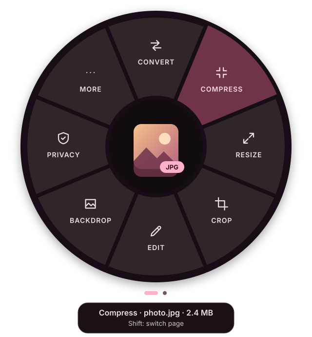

<p align="center">
  
</p>

<h1 align="center">Dropwheel</h1>

<p align="center">
  <b>A radial wheel of file actions for Linux and Windows.</b><br>
  Drag files, tap <kbd>Shift</kbd>, drop on a segment: converted, compressed, cropped, redacted, shared.
</p>

<p align="center">
  
  
  
  
  
  
  
  
  <a href="LICENSE"></a>
</p>

<p align="center">
  <b>English</b> · <a href="README.it.md">Italiano</a>
</p>

---

Dropwheel brings the idea of [Tangerine](https://tangerineformac.com) for macOS to Linux and Windows. While you
drag files from any application, tap <kbd>Shift</kbd> and a wheel appears under the pointer with the
actions that make sense for those files. Drop them on a segment and the job starts. A small card in
the corner of the screen shows the progress and then the result, which you can open, reveal, copy,
undo or drag straight into another application.

Everything runs **on your computer**, using free tools you probably already have, such as FFmpeg,
Ghostscript, LibreOffice and Tesseract. There are no accounts, no cloud services and no telemetry.

<p align="center">
  
  <br><sub>Illustration of the wheel for an image file. Colours follow your Caelestia theme.</sub>
</p>

> [!IMPORTANT]
> **Dropwheel runs on Arch Linux with Hyprland, GNOME or KDE Plasma, on Debian, Ubuntu, Fedora and openSUSE
> with GNOME or KDE Plasma, and in preview on Windows 10 and 11 and macOS 13 or later.**
> The GNOME, KDE Plasma, Windows and macOS versions are new and have not yet run on a real GNOME, Plasma,
> Windows or Mac machine: see [Platform support](#platform-support).
>
> This is an early release. The code has an extensive automated test suite, but the complete
> drag-and-drop flow has not yet been exercised on a live Hyprland session, and many paths that call
> external programs have only run against test doubles. Expect rough edges, and please
> [open an issue](https://github.com/haxurus/dropwheel/issues) when you find one.

## Contents

- [Highlights](#highlights)
- [Platform support](#platform-support)
- [Quick start](#quick-start)
- [Documentation](#documentation)
- [Credits and license](#credits-and-license)

## Highlights

- **448 actions, chosen by file type.** Images, PDF, office documents, Markdown, code, data files,
  ebooks, subtitles, audio, video, archives, fonts, folders, web links, AppImages and disk images.
- **Only what makes sense.** A PDF is not offered "Convert to PDF". Selecting several files adds
  group actions such as merging PDFs or turning images into a slideshow.
- **Your originals are safe.** Tools write a new file next to the original and never overwrite an
  existing one. The only actions that touch the source are those that say so, such as Rename, Move
  and Trash. **Undo** sends a job's results to the trash.
- **Real redaction.** PDF redaction removes the underlying text and images, then reads the result
  back to verify they are gone.
- **Editors where you need them.** Crop, redact, trim, PDF page organizer, metadata, colour
  adjustment and background composer, all with previews.
- **Clear failures.** A feature whose program is missing is greyed out and shows the exact command
  that installs it. One failed file never stops the rest of a batch.
- **At home on Caelestia.** Colours, transparency and motion follow your theme. It also works without
  Caelestia, using a dark Material 3 palette.
- **Scriptable.** The same actions are available from a command line with JSON output.
- **Bilingual.** The interface is available in English and Italian.

## Platform support

| Platform | Status |
|---|---|
| Arch Linux, Hyprland 0.57+, Caelestia | **Primary target** |
| Arch Linux, Hyprland 0.57+, without Caelestia | **Supported**, with a built-in dark palette |
| Arch Linux, GNOME 45+ | **New**: the same wheel, through a small GNOME Shell extension. See [Dropwheel on GNOME](docs/GNOME.md) |
| Debian 13, Ubuntu 24.04 or later, GNOME | **New**: as above, installed with apt. See [Dropwheel on GNOME](docs/GNOME.md) |
| Fedora 43 or later, openSUSE Tumbleweed and Leap 16, GNOME | **New**: as above, installed with dnf or zypper. See [Dropwheel on GNOME](docs/GNOME.md) |
| Arch Linux, Debian 13, Ubuntu or Kubuntu 25.04 or later, Fedora 43 or later, openSUSE Tumbleweed and Leap 16, KDE Plasma 6 | **New**: the same wheel, through a small KWin script, on Wayland and X11. See [Dropwheel on KDE Plasma](docs/KDE.md) |
| Arch-based distributions | Expected to work with the same packages, not tested |
| Other compositors, other distributions | Not yet |
| Windows 10 and 11 | **Preview**: the same wheel, job cards and editors, Shift during a drag from Explorer, hot corner, shortcut, context menu. Not yet tested on real Windows. See [Dropwheel on Windows](docs/WINDOWS.md) |
| macOS 13 or later, Apple silicon and Intel | **Preview**: the same wheel, Shift during a drag from the Finder, hot corner, a Finder Quick Action, start at login; no shortcut yet. Never run on a real Mac. See [Dropwheel on macOS](docs/MACOS.md) |

### Where this is going

Arch and Hyprland are where the project started; GNOME and Windows came next. **The goal is to
extend Dropwheel to other operating systems** and desktops. There is no schedule yet, and the order will
depend on what people need and who wants to help.

The architecture keeps most of the hard work portable, because the interface talks to the engine
through a small JSON protocol:

| Layer | Today | What a port needs |
|---|---|---|
| Action engine (Python) | Linux, plus Windows and macOS branches in preview for paths, trash, clipboard, processes and install hints | Notifications on Windows and macOS |
| Protocol | JSON lines over stdio | Nothing: any front end can speak it |
| Command line | Needs no compositor | Mostly nothing: a natural first step on a new platform |
| Trigger | Hyprland global shortcuts and `hyprctl`; on GNOME, a Shell extension; on KDE Plasma, a KWin script; on Windows and macOS, the Shift and mouse state (plus a registered hotkey on Windows) | A new way to detect Shift during a drag on each platform |
| Wheel and dialogs | Quickshell, Wayland layer-shell; on GNOME, KDE Plasma, Windows and macOS, the same QML hosted by PySide6 | Other desktops could start from the PySide6 host |
| Packaging | `PKGBUILD`; interactive `install.sh` (Arch, Debian, Ubuntu, Fedora, openSUSE, macOS) and `install.ps1` (Windows) | Native packages for each system |

If you would like to see Dropwheel on your system, an
[issue](https://github.com/haxurus/dropwheel/issues) describing your setup is a useful start.

## Quick start

On **Arch Linux, Debian, Ubuntu, Fedora, openSUSE or macOS** (macOS: preview, with Homebrew), in a terminal:

```sh
curl -fsSL https://raw.githubusercontent.com/haxurus/dropwheel/main/install.sh | bash
```

On **Windows 10 or 11** (preview), in PowerShell:

```powershell
irm https://raw.githubusercontent.com/haxurus/dropwheel/main/install.ps1 | iex
```

The installer recognises the system and the desktop (Hyprland, GNOME, KDE Plasma, Windows or macOS), asks which
features you want, installs what is missing (with your password, once) and starts Dropwheel. Then drag some files and
tap <kbd>Shift</kbd>. On GNOME, log out and back in once first.

The details are in the [installation guide](docs/INSTALL.md), [Dropwheel on GNOME](docs/GNOME.md),
[Dropwheel on KDE Plasma](docs/KDE.md), [Dropwheel on Windows](docs/WINDOWS.md) and
[Dropwheel on macOS](docs/MACOS.md). On Arch, `makepkg -si` builds a system package instead.

## Documentation

The complete documentation is in the [docs](docs/README.md) folder.

| Guide | What you will find |
|---|---|
| [Installing](docs/INSTALL.md) | Requirements, Arch package or `install.sh`, Hyprland setup, optional programs, updating, uninstalling |
| [Using Dropwheel](docs/USAGE.md) | The five ways to open the wheel, gestures and keys, job cards, configuration, file managers |
| [What it can do](docs/FEATURES.md) | Actions by file type, several files at once, where results go |
| [Command line](docs/CLI.md) | Every `dropwheel` command, exit codes, environment variables |
| [Configuration reference](docs/CONFIG.md) | Every key of `config.toml` and custom actions |
| [Function reference](docs/FUNCTIONS.md) | Every action, ring by ring, with the programs it needs |
| [Troubleshooting](docs/TROUBLESHOOTING.md) | The wheel does not appear, logs, missing icons, greyed out features |
| [Privacy and security](docs/PRIVACY.md) | What uses the network and how untrusted files are handled |
| [GNOME](docs/GNOME.md) | Debian, Ubuntu, Fedora, openSUSE and Arch with GNOME: installing, the extension, differences from Hyprland |
| [KDE Plasma](docs/KDE.md) | Debian, Ubuntu, Fedora, openSUSE and Arch with Plasma 6: installing, the KWin script, differences from Hyprland |
| [Windows](docs/WINDOWS.md) | The Windows preview: installing, the wheel from Explorer, differences from Linux |
| [macOS](docs/MACOS.md) | The macOS preview, never run on a real Mac: Homebrew, the Finder Quick Action, differences from Linux |
| [Architecture and development](docs/DEVELOPMENT.md) | How the pieces fit, running from a checkout, tests |
| [Changelog](CHANGELOG.md) | What changed in each version |

## Credits and license

- The idea and the workflow come from **[Tangerine](https://tangerineformac.com)** for macOS, with
  inspiration from OpenShelf and DragShift. Dropwheel is not affiliated with these projects.
- The visual language comes from **[Caelestia](https://github.com/caelestia-dots)**. Dropwheel is built
  with **[Hyprland](https://hypr.land)** and **[Quickshell](https://quickshell.org)**, with Google's
  Material Symbols icons.
- The real work is done by outstanding free software, including FFmpeg, Pillow, ImageMagick, libvips,
  PyMuPDF, pypdf, qpdf, Ghostscript, Poppler, LibreOffice, pandoc, Typst, Tesseract, OCRmyPDF,
  whisper.cpp, ExifTool, 7-Zip, calibre, fontTools and yt-dlp, each under its own license.

Dropwheel is released under the [MIT License](LICENSE).
