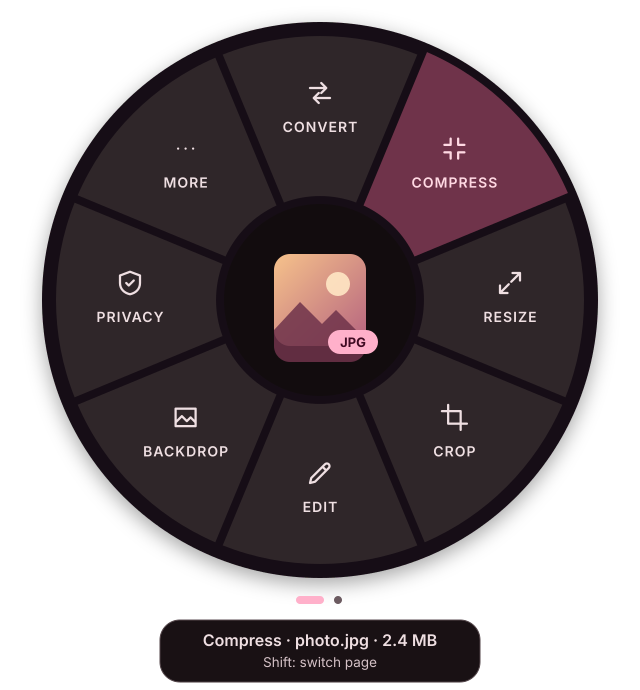
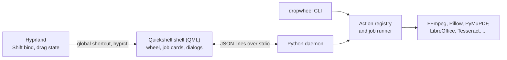

<p align="center">
  
</p>

<h1 align="center">Dropwheel</h1>

<p align="center">
  <b>A radial wheel of file actions for your Linux desktop.</b><br>
  Drag files, tap <kbd>Shift</kbd>, drop on a segment: converted, compressed, cropped, redacted, shared.
</p>

<p align="center">
  
  
  
  
  
  <a href="LICENSE"></a>
</p>

<p align="center">
  <b>English</b> · <a href="README.it.md">Italiano</a>
</p>

---

Dropwheel brings the idea of [Tangerine](https://tangerineformac.com) for macOS to Linux. While you
drag files from any application, tap <kbd>Shift</kbd> and a wheel appears under the pointer with the
actions that make sense for those files. Drop them on a segment and the job starts. A small card in
the corner of the screen shows the progress and then the result, which you can open, reveal, copy,
undo or drag straight into another application.

Everything runs **on your computer**, using free tools you probably already have, such as FFmpeg,
Ghostscript, LibreOffice and Tesseract. There are no accounts, no cloud services and no telemetry.

<p align="center">
  
  <br><sub>Illustration of the wheel for an image file. Colours follow your Caelestia theme.</sub>
</p>

> [!IMPORTANT]
> **Dropwheel currently runs on Arch Linux with Hyprland only.** The goal is to extend it to other
> operating systems: see [Platform support](#platform-support).
>
> This is an early release. The code has an extensive automated test suite, but the complete
> drag-and-drop flow has not yet been exercised on a live Hyprland session, and many paths that call
> external programs have only run against test doubles. Expect rough edges, and please
> [open an issue](https://github.com/haxurus/dropwheel/issues) when you find one.

## Contents

- [Highlights](#highlights)
- [Platform support](#platform-support)
- [Quick start](#quick-start)
- [How to use it](#how-to-use-it)
- [What it can do](#what-it-can-do)
- [Optional dependencies](#optional-dependencies)
- [Configuration](#configuration)
- [File manager integration](#file-manager-integration)
- [Command line](#command-line)
- [Troubleshooting](#troubleshooting)
- [Privacy and security](#privacy-and-security)
- [Architecture](#architecture)
- [Development](#development)
- [Uninstalling](#uninstalling)
- [Credits and license](#credits-and-license)

## Highlights

- **448 actions, chosen by file type.** Images, PDF, office documents, Markdown, code, data files,
  ebooks, subtitles, audio, video, archives, fonts, folders, web links, AppImages and disk images.
- **Only what makes sense.** A PDF is not offered "Convert to PDF". Selecting several files adds
  group actions such as merging PDFs or turning images into a slideshow.
- **Your originals are safe.** Tools write a new file next to the original and never overwrite an
  existing one. The only actions that touch the source are those that say so, such as Rename, Move
  and Trash. **Undo** sends a job's results to the trash.
- **Real redaction.** PDF redaction removes the underlying text and images, then reads the result
  back to verify they are gone.
- **Editors where you need them.** Crop, redact, trim, PDF page organizer, metadata, colour
  adjustment and background composer, all with previews.
- **Clear failures.** A feature whose program is missing is greyed out and shows the exact command
  that installs it. One failed file never stops the rest of a batch.
- **At home on Caelestia.** Colours, transparency and motion follow your theme. It also works without
  Caelestia, using a dark Material 3 palette.
- **Scriptable.** The same actions are available from a command line with JSON output.
- **Bilingual.** The interface is available in English and Italian.

## Platform support

| Platform | Status |
|---|---|
| Arch Linux, Hyprland 0.57+, Caelestia | **Primary target** |
| Arch Linux, Hyprland 0.57+, without Caelestia | **Supported**, with a built-in dark palette |
| Arch-based distributions | Expected to work with the same packages, not tested |
| Other Linux distributions | Not yet |
| Other Wayland compositors, X11 | Not yet |
| Windows, macOS | Not yet |

### Where this is going

Arch and Hyprland are where the project started, not where it is meant to stop. **The goal is to
extend Dropwheel to other operating systems.** There is no schedule yet, and the order will depend on
what people need and who wants to help.

The architecture keeps most of the hard work portable, because the interface talks to the engine
through a small JSON protocol:

| Layer | Today | What a port needs |
|---|---|---|
| Action engine (Python) | Written for Linux, mostly platform-neutral | Platform code for paths, trash, clipboard and notifications; the dependency tables name Arch packages |
| Protocol | JSON lines over stdio | Nothing: any front end can speak it |
| Command line | Needs no compositor | Mostly nothing: a natural first step on a new platform |
| Trigger | Hyprland global shortcuts and `hyprctl` | A new way to detect Shift during a drag on each platform |
| Wheel and dialogs | Quickshell, Wayland layer-shell | Other Wayland compositors may reuse them; other systems need a new front end |
| Packaging | `PKGBUILD`, `install.sh` | Native packages for each system |

If you would like to see Dropwheel on your system, an
[issue](https://github.com/haxurus/dropwheel/issues) describing your setup is a useful start.

## Quick start

**Requirements**

| | |
|---|---|
| **System** | Arch Linux or a derivative, on Wayland |
| **Hyprland** | 0.57 or later, with Lua configuration |
| **Quickshell** | 0.3.2 or later (`quickshell` or `quickshell-git`) |
| **Python** | 3.11 or later, with Pillow |
| **Other packages** | `wl-clipboard`, `libnotify`, `ttf-material-symbols-variable`, `glib2`, `xdg-utils` |
| **Caelestia** | Recommended, not required |

**Install as an Arch package (recommended)**

```sh
git clone https://github.com/haxurus/dropwheel.git
cd dropwheel
makepkg -si
```

The `PKGBUILD` builds from the folder you are in, and pacman tracks every file.

**Or install into your home directory, without root**

```sh
git clone https://github.com/haxurus/dropwheel.git
cd dropwheel
./install.sh
```

The script installs under `~/.local`, checks dependencies and prints the command for anything
missing. It never runs `sudo`. See `./install.sh --help` for the options.

**Then, as your normal user, connect it to Hyprland**

```sh
dropwheel setup hyprland   # Shift, SUPER+ALT+D, layer rules and autostart
hyprctl reload
dropwheel start            # from the next login it starts by itself
dropwheel doctor           # shows what is installed and what is missing
```

Now start dragging a file and tap <kbd>Shift</kbd>.

<details>
<summary><b>What <code>dropwheel setup hyprland</code> changes</b></summary>

<br>

With Caelestia, it copies the Lua module to `~/.config/caelestia/dropwheel.lua` and, after making a
backup, appends one line to `~/.config/caelestia/hypr-user.lua`:

```lua
require("dropwheel")
```

The module registers:

| What | Details |
|---|---|
| `Shift_L`, `Shift_R` | `hl.dsp.global("dropwheel:shift")`, `non_consuming` so applications still receive Shift, `ignore_mods` so it also works while holding Ctrl or Alt |
| `SUPER + ALT + D` | `hl.dsp.global("dropwheel:open")`, opens the wheel with the files on the clipboard |
| Layer rules | Blur and no Hyprland animation on `dropwheel-wheel` and `dropwheel-hud`; no animation on `dropwheel-dialog` and `dropwheel-hotzone` |
| Autostart | `hl.on("hyprland.start", ...)` runs `dropwheel start` |

The options are at the top of the copied file: the open shortcut, the Shift keys, autostart and blur.

Without Caelestia, copy the module to `~/.config/hypr/` and add this to
`~/.config/hypr/hyprland.lua`:

```lua
package.path = package.path .. ";" .. os.getenv("HOME") .. "/.config/hypr/?.lua"
require("dropwheel")
```

</details>

**Updating**

```sh
git pull
makepkg -sif               # or: ./install.sh
dropwheel stop && dropwheel start
```

The `f` matters: the version does not change on every commit, so without it makepkg reinstalls the
package it built last time.

## How to use it

There are five ways to open the wheel.

1. **Shift during a drag.** Start dragging, tap <kbd>Shift</kbd>, move to a segment and release. This
   is the main way. Dropwheel checks that a drag is really in progress, so Shift keeps working normally
   while you type.
2. **The hot corner.** Drag files onto the 6×6 pixel area in the top-right corner of the screen. The
   corner, size and even its presence are configurable.
3. **SUPER+ALT+D.** Copy files in your file manager and press the shortcut. With nothing on the
   clipboard, you get an empty target to drop files on.
4. **The file manager.** Right-click files and choose **Open in Dropwheel**.
5. **The terminal.** Run `dropwheel open photo.heic`.

**During a drag**

| Gesture | Effect |
|---|---|
| Tap <kbd>Shift</kbd> | Opens the wheel; when it is open, switches between the **Tools** and **File** pages |
| Rest on a group for 450 ms | Opens the ring of that group |
| Rest on the centre for 450 ms | Goes back to the previous ring |
| Drop on an action | Runs it, or opens its editor |
| Drop on a group | Keeps the wheel open on that ring, in click mode |
| Drop on the centre or outside | Cancels |
| <kbd>Esc</kbd> | Cancels the drag and closes the wheel |

**In click mode** (after SUPER+ALT+D, the hot corner, the file manager, or a drop on a group)

| Key or gesture | Effect |
|---|---|
| Arrows, <kbd>Tab</kbd>, mouse wheel | Move the highlight |
| <kbd>1</kbd> to <kbd>8</kbd> | Run segment N, clockwise from noon |
| <kbd>Enter</kbd> or click | Run the action or open the group |
| <kbd>Alt</kbd>+<kbd>Enter</kbd> or right-click | Set the parameters of a quick action first |
| <kbd>Backspace</kbd> or click on the centre | Go back |
| <kbd>Esc</kbd> | Go back; on the main ring, close |
| <kbd>Shift</kbd> or <kbd>Ctrl</kbd>+<kbd>Tab</kbd> | Switch page |

**Job cards**

After a drop, a card appears in the bottom-right corner. While running, it shows progress and a cancel
button. When finished, it shows a preview, the size saved and buttons to **Open**, **Show in folder**,
**Copy** and **Undo**. You can also **drag the result** straight into a browser, chat or email. Failed
jobs stay until you close them, with the details and, when a program is missing, a button that copies
the install command.

## What it can do

The ring adapts to the file, so the exact entries vary. Rings hold at most eight segments, and extra
entries move to **More**.

| File type | Actions |
|---|---|
| **Images** (JPG, PNG, WebP, AVIF, HEIC, JPEG XL, TIFF, BMP, ICO, PSD) | Convert, compress (including to a target size), resize (with social media presets), crop, rotate, flip, adjust colours, annotate, watermark, remove or add a background, strip location or all metadata, redact, OCR, read QR codes, AI upscale, vectorize, make icons, set as wallpaper, print |
| **Animated images** (GIF, WebP, APNG) | Convert to MP4 or WebM, compress, resize, crop, rotate, extract frames, reverse, change speed |
| **SVG** | Convert to PNG, PDF, JPG, WebP or ICO, optimize, copy as text or image, make icons |
| **PDF** | Convert to DOCX, JPG, PNG, TXT, Markdown, EPUB, HTML or PDF/A; compress; organize, split, extract, delete and rotate pages; protect with AES-256 or unlock; true redaction; edit metadata; OCR; extract images and attachments; annotate; watermark; page numbers; flatten; repair |
| **Documents** (DOCX, DOC, ODT, RTF) | Convert to PDF, ODT, Markdown, TXT, HTML, EPUB or RTF, compress embedded images, remove personal data, extract images and text, password-protected PDF, statistics |
| **Spreadsheets** (XLSX, ODS, XLS, CSV, TSV) | Convert to ODS, CSV, PDF, JSON, Markdown table, HTML or TSV, remove metadata, sheet info |
| **Presentations** (PPTX, ODP, PPT) | Convert to PDF, ODP or images, compress media, extract text, speaker notes and images, remove metadata |
| **Markdown** | Convert to PDF, HTML, DOCX, ODT, EPUB, TXT or RTF, slides, table of contents, formatting, statistics |
| **Text and code** | Export to PDF, HTML, DOCX or Markdown with syntax highlighting, convert to UTF-8, fix line endings, trim spaces, statistics |
| **Data** (JSON, YAML, TOML, XML) | Convert between formats and to CSV or XLSX, format, minify, validate, sort keys |
| **Ebooks** (EPUB, MOBI, AZW3, FB2, CBZ) | Convert, extract the cover, book info |
| **Subtitles** (SRT, VTT, ASS) | Convert, shift timing, change frame rate, remove SDH tags, plain text |
| **Audio** (MP3, M4A, FLAC, WAV, Opus, OGG) | Convert, compress, trim, normalize to EBU R128 targets, edit tags and cover, transcribe locally with whisper.cpp, change speed, fade, remove silence, reduce noise, waveform video |
| **Video** (MP4, MKV, WebM, MOV, AVI) | Convert, compress (including a WhatsApp/Telegram preset and target size), trim, crop, resize, mute, rotate, change speed, reverse, loop, stabilize, extract audio, frames and subtitles, contact sheet, generate or burn in subtitles, split, edit metadata |
| **Archives** (ZIP, 7Z, RAR, TAR, GZ, XZ, ZST) | Smart extract, extract to a folder, list, test, convert, add a password |
| **Fonts** (TTF, OTF, WOFF, WOFF2) | Install, preview sheet, convert, web kit, subset, info |
| **Folders** | Compress, batch rename, size breakdown, find duplicates, create SHA256SUMS, list contents, flatten |
| **Web links** | Download, save video or audio with yt-dlp, QR code, copy clean link, save page as PDF, create a shortcut |
| **AppImage, disk images, packages** | Add to menu, run, mount read-only, verify, inspect, extract |
| **Unknown files** | Identify the real type, checksums, hex view, strings, encrypt |

Every file also has a **File** page: copy, copy path, move, rename, duplicate, ZIP, open with, share
(QR code for your phone, KDE Connect, LocalSend, email), properties, checksums, encrypt with GnuPG,
open a terminal here, and trash.

**Several files at once.** Files of the same type get group actions, for example images to PDF, GIF,
slideshow or collage; merging PDFs, videos or audio; or combining documents into one PDF. Mixed
selections get what applies to all of them.

**Where results go**

| Operation | Example |
|---|---|
| Conversion | `photo.heic` produces `photo.jpg` |
| Tool on the same format | `photo.jpg` produces `photo (Compressed).jpg` |
| Name already taken | `photo 2.jpg`, `photo 3.jpg`, and so on, never an overwrite |
| Several outputs | A folder such as `document (Pages)/` |
| Read-only or temporary source | `~/Downloads/Dropwheel`, and the card tells you |

The complete list of actions, ring by ring and with the programs they need, is in
[docs/FUNCTIONS.md](docs/FUNCTIONS.md).

## Optional dependencies

Only the [requirements](#quick-start) are mandatory. Everything else enables individual features, and
`dropwheel doctor` shows what is missing. Dropwheel never runs `sudo` for you.

A good base that covers most features:

```sh
sudo pacman -S --needed python-pillow-heif python-pillow-jpegxl-plugin oxipng pngquant jpegoptim \
    gifski perl-image-exiftool tesseract tesseract-data-eng zbar python-qrcode \
    python-pymupdf python-pypdf qpdf ghostscript poppler libreoffice-fresh pandoc-cli typst \
    ffmpeg python-mutagen 7zip python-fonttools python-brotli
```

<details>
<summary><b>Full list by feature</b></summary>

<br>

**Official repositories**

| Feature | Packages |
|---|---|
| HEIC and JPEG XL | `python-pillow-heif python-pillow-jpegxl-plugin` |
| Image optimization | `oxipng pngquant jpegoptim libjpeg-turbo` |
| GIF and animation | `gifski gifsicle libwebp-utils` |
| Unusual formats, huge images | `imagemagick libheif libvips` |
| SVG | `librsvg resvg potrace inkscape scour` or `svgo` |
| Metadata and privacy | `perl-image-exiftool mat2` |
| OCR | `tesseract tesseract-data-eng`, plus your languages |
| QR codes and barcodes | `zbar python-qrcode qrencode` |
| Annotation | `satty` or `swappy`, `xournalpp` for PDF |
| AI upscaling | `waifu2x-ncnn-vulkan` |
| PDF | `python-pymupdf python-pypdf python-pikepdf python-cryptography qpdf ghostscript poppler mupdf-tools img2pdf` |
| Office documents | `libreoffice-fresh` or `libreoffice-still`, `python-openpyxl python-docx` |
| Markdown, text, code | `pandoc-cli typst python-weasyprint python-pygments python-charset-normalizer` |
| Structured data | `python-yaml python-tomli-w python-defusedxml` |
| Ebooks | `calibre` |
| Audio and video | `ffmpeg python-mutagen` |
| Transcription and subtitles | `whisper-cpp` |
| Downloads from links | `yt-dlp deno` |
| Archives | `7zip unrar unarchiver` |
| Fonts | `python-fonttools python-brotli` |
| AppImage | `squashfs-tools` |
| Sending to a phone | `kdeconnect` |
| System | `gnupg udisks2 trash-cli zenity gtk3 xdg-terminal-exec` |
| Colour picker in dialogs | `hyprpicker` |
| Printing | `cups` |
| XXH128 checksums | `xxhash` |
| Web page to PDF | `chromium` or another Chromium-based browser |

**AUR**

| Package | Purpose |
|---|---|
| `ocrmypdf` | Making scanned PDFs searchable |
| `python-pdf2docx` | More faithful PDF to Word conversion |
| `vtracer` | Colour vectorization |
| `realesrgan-ncnn-vulkan-bin` | ×4 upscaling with Real-ESRGAN |
| `localsend-cli-bin` | Sending with LocalSend |

**pipx**

| Command | Purpose |
|---|---|
| `pipx install "rembg[cpu,cli]"` | Background removal; downloads an AI model on first use |

</details>

## Configuration

No configuration is needed. To start from a commented file at `~/.config/dropwheel/config.toml`:

```sh
dropwheel config --init
```

Changes apply the next time the wheel opens. An invalid value falls back to its default with a
warning, and never blocks anything. For example:

```toml
language = "en"                     # auto | it | en
hidden_actions = ["image.background.*"]

[output]
location = "source"                 # next to the original; "folder" = always the folder below
folder = "~/Downloads/Dropwheel"

[hotzone]
corner = "bottom-left"

[image]
jpeg_quality = 82

# Your own actions, shown in the wheel next to the built-in ones
[[custom]]
id = "blog-image"
label = "For the blog"
icon = "web"
categories = ["image"]
command = "magick {file} -resize '1600x1600>' -quality 80 {dir}/{stem}-blog.jpg"
output = "files"
```

Every key, with examples of custom actions, is documented in [docs/CONFIG.md](docs/CONFIG.md).

## File manager integration

| File manager | How | In the menu |
|---|---|---|
| **Thunar** (Caelestia's default) | `dropwheel setup thunar --apply` | Open in Dropwheel |
| **Nautilus** | `dropwheel setup nautilus` | Scripts, then Dropwheel |
| **Dolphin** | Included in the package, or `dropwheel setup dolphin` | Open in Dropwheel |
| **Nemo** | Included in the package, or `dropwheel setup nemo` | Open in Dropwheel |

Caelestia manages Thunar's `uca.xml`, so Dropwheel only changes it when you pass `--apply`, and it
makes a backup first. See [integrations/thunar/README.md](integrations/thunar/README.md) for the manual
steps.

## Command line

```sh
dropwheel open ~/Pictures/photo.heic             # the wheel, in click mode
dropwheel menu --json document.pdf               # available actions, as JSON
dropwheel run image.compress.balanced photo.jpg  # run an action without the interface
```

| Command | Description |
|---|---|
| `dropwheel start`, `stop`, `restart`, `status` | Control the shell and background service |
| `dropwheel open [FILE...]` | Open the wheel for files or URLs; without arguments, uses the clipboard |
| `dropwheel menu FILE... [--json]` | Show the actions available for files |
| `dropwheel actions [-c CATEGORY] [--json]` | List every action and whether it is available |
| `dropwheel run ACTION FILE... [-p KEY=VALUE]... [--json]` | Run an action; a group id runs its default |
| `dropwheel undo [JOB]`, `history [-n N]` | Undo a job (the last one by default), show recent jobs |
| `dropwheel doctor [--json] [--full]` | Check Hyprland, Quickshell and tools, with install commands |
| `dropwheel setup hyprland\|nautilus\|dolphin\|nemo\|thunar\|desktop\|all` | Install an integration |
| `dropwheel shares [--stop ID\|--stop-all]` | List or stop active LAN shares |
| `dropwheel config [--path\|--init\|--edit]` | Show, create or edit the configuration |

Exit codes are `0` for success, `1` for an error, `2` for incorrect usage and `130` for an interruption.

## Troubleshooting

Always start with `dropwheel doctor`.

<details>
<summary><b>The wheel does not appear when I press Shift</b></summary>

<br>

1. **Is it running?** `hyprctl globalshortcuts` must list `dropwheel:shift` and `dropwheel:open`. If
   not, run `dropwheel start` from a terminal and read any errors.
2. **Are the binds loaded?** `hyprctl binds | grep -i -B2 -A8 dropwheel` must show them. If not, run
   `dropwheel setup hyprland`, then `hyprctl reload`.
3. **Does it appear only when you release Shift?** That is normal if you have binds starting with
   Shift, because Hyprland waits to see whether you are typing a longer combination. Tap Shift instead
   of holding it.
4. **Are you dragging from an XWayland application?** Drag-and-drop from X11 clients to Wayland surfaces
   does not work in Hyprland 0.57. Check with `hyprctl clients` (`xwayland: 1`). Run the application in
   Wayland mode, or copy the files and use SUPER+ALT+D.
5. **Still nothing?** As a test, set `dnd_check = false` under `[trigger]` in `config.toml`. The wheel
   then opens on every Shift and closes by itself if no drag arrives.

</details>

<details>
<summary><b>Where are the logs?</b></summary>

<br>

```sh
qs log -p /usr/share/dropwheel/shell -f            # system package
qs log -p ~/.local/share/dropwheel/shell -f        # install.sh
```

The shell log includes errors from the Python service. Commands started by Hyprland send their output
to `/dev/null`, so run `dropwheel start` from a terminal to see startup errors.

</details>

<details>
<summary><b>The icons are squares or letters</b></summary>

<br>

The icon font is missing. Run `sudo pacman -S ttf-material-symbols-variable`, then `fc-cache -f`, then
`dropwheel stop && dropwheel start`.

</details>

<details>
<summary><b>A feature is greyed out</b></summary>

<br>

The program it needs is not installed. Hover the segment to see which one and the command to install
it. Dropwheel checks again every ten minutes, or immediately after `dropwheel stop && dropwheel start`.

</details>

<details>
<summary><b>The result ended up in ~/Downloads/Dropwheel</b></summary>

<br>

This happens when the original is in a read-only or temporary location, such as a browser download in
progress, `/tmp` or a file shared by a Flatpak app. To always use one folder, set
`output.location = "folder"`.

</details>

<details>
<summary><b>Does pressing Shift make the source application move my files?</b></summary>

<br>

Hyprland also forwards Shift to the source application, where it often means "move". Dropwheel always
reads files as a copy and never moves or deletes them on drop. If you open the wheel and then drop in a
different application, release Shift first.

</details>

## Privacy and security

- **Everything is local.** There is no telemetry, cloud service or account.
- **The network is used only when you ask:**
  - *QR code for your phone* starts a temporary HTTP server on the local network, on a random port and
    address, which serves only the chosen files and stops after 15 minutes or when you close the card.
  - *KDE Connect and LocalSend* send to your paired devices.
  - *Dropped links* are downloaded only from that link's site.
  - *AI models* are downloaded only when you install or first use the feature.
- **Nothing you drop is executed.** Document macros and PDF JavaScript never run, an AppImage is
  inspected without starting it, and remote images in Markdown and external references in SVG are not
  fetched.
- **Untrusted files are handled defensively.** Dangerous archive entries, such as absolute paths, `..`
  and links pointing outside the archive, are rejected, and there are guards against archive and
  document bombs.
- **Passwords** stay in memory only for the job that uses them.

When redacting images, blur and pixelate can be reversible on text. Use a solid box for sensitive data.

## Architecture



- **Shell (`shell/`).** A Quickshell configuration launched by path, so it never interferes with
  Caelestia's own shell.
- **Daemon (`src/dropwheel/daemon.py`).** Answers menu, preview and job requests on stdin and stdout.
- **Actions (`src/dropwheel/actions/`).** One module per family, registered with a decorator that
  declares categories, parameters and required tools. Menus are built from those declarations.
- **Jobs (`src/dropwheel/jobs.py`).** Parallelism, cancellation, progress, atomic output, undo.

[docs/ARCHITECTURE.md](docs/ARCHITECTURE.md) explains how to add an action or a translation, and
[docs/SPEC.md](docs/SPEC.md) is the full contract.

## Development

```sh
PYTHONPATH=src python -m dropwheel doctor
PYTHONPATH=src python -m dropwheel start   # uses shell/ and integrations/ from this checkout
make test                                  # pytest
make lint                                  # Python, scripts, Lua, XML, desktop entries, QML
```

Contributions are welcome, and reports from real Hyprland sessions are especially valuable right now.
So is help with bringing Dropwheel to [other systems](#where-this-is-going).

## Uninstalling

**System package**

```sh
sudo pacman -Rns dropwheel
```

Then remove the `require("dropwheel")` line from `~/.config/caelestia/hypr-user.lua`, delete
`~/.config/caelestia/dropwheel.lua` and run `hyprctl reload`.

**install.sh**

```sh
~/.local/share/dropwheel/uninstall.sh           # keeps your settings and data
~/.local/share/dropwheel/uninstall.sh --purge   # also deletes them, after asking
```

Files you created with Dropwheel are never deleted.

## Credits and license

- The idea and the workflow come from **[Tangerine](https://tangerineformac.com)** for macOS, with
  inspiration from OpenShelf and DragShift. Dropwheel is not affiliated with these projects.
- The visual language comes from **[Caelestia](https://github.com/caelestia-dots)**. Dropwheel is built
  with **[Hyprland](https://hypr.land)** and **[Quickshell](https://quickshell.org)**, with Google's
  Material Symbols icons.
- The real work is done by outstanding free software, including FFmpeg, Pillow, ImageMagick, libvips,
  PyMuPDF, pypdf, qpdf, Ghostscript, Poppler, LibreOffice, pandoc, Typst, Tesseract, OCRmyPDF,
  whisper.cpp, ExifTool, 7-Zip, calibre, fontTools and yt-dlp, each under its own license.

Dropwheel is released under the [MIT License](LICENSE).
