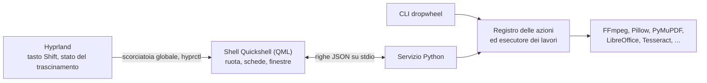

[Documentazione](README.it.md) · [English](DEVELOPMENT.md)

# Architettura e sviluppo

## Architettura



- **Shell (`shell/`).** Una configurazione Quickshell avviata indicando il percorso, quindi non interferisce
  mai con la shell di Caelestia.
- **Servizio (`src/dropwheel/daemon.py`).** Risponde a richieste di menu, anteprime e lavori su stdin e stdout.
- **Azioni (`src/dropwheel/actions/`).** Un modulo per famiglia, registrato con un decoratore che dichiara
  categorie, parametri e strumenti richiesti. I menu sono costruiti da queste dichiarazioni.
- **Lavori (`src/dropwheel/jobs.py`).** Parallelismo, interruzione, avanzamento, scrittura atomica, annulla.
- **Host Qt per Windows, macOS, GNOME e KDE Plasma (`src/dropwheel/qtshell/`).** Un programma PySide6 che carica lo stesso
  `shell/shell.qml` attraverso piccoli sostituti dei moduli di Quickshell, e risponde da sé ai comandi di
  Hyprland; `win32.py`, `macos.py` (Quartz tramite `ctypes`), `gnome.py` (con l'estensione della Shell in `integrations/gnome/`) e `kde.py` (con lo
  script di KWin in `integrations/kde/`) forniscono Shift e il puntatore.
  `tests/test_qtshell.py` lo avvia senza schermo su Linux.

[docs/ARCHITECTURE.md](ARCHITECTURE.md) spiega come aggiungere un'azione o una traduzione, e
[docs/SPEC.md](SPEC.md) è il contratto completo. Entrambi sono in inglese.

## Sviluppo

```sh
PYTHONPATH=src python -m dropwheel doctor
PYTHONPATH=src python -m dropwheel start   # usa shell/ e integrations/ di questa cartella
make test                                  # pytest
make lint                                  # Python, script, Lua, XML, voci .desktop, QML
```

I contributi sono benvenuti, e in questo momento sono particolarmente preziose le segnalazioni da vere sessioni
Hyprland. Lo stesso vale per l'aiuto a portare Dropwheel su [altri sistemi](../README.it.md#dove-stiamo-andando).

---

← [Precedente](PRIVACY.it.md) · [Documentazione](README.it.md) →
