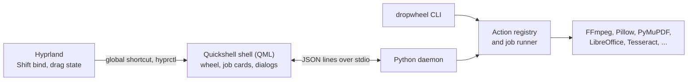

[Documentation](README.md) · [Italiano](DEVELOPMENT.it.md)

# Architecture and development

## Architecture



- **Shell (`shell/`).** A Quickshell configuration launched by path, so it never interferes with
  Caelestia's own shell.
- **Daemon (`src/dropwheel/daemon.py`).** Answers menu, preview and job requests on stdin and stdout.
- **Actions (`src/dropwheel/actions/`).** One module per family, registered with a decorator that
  declares categories, parameters and required tools. Menus are built from those declarations.
- **Jobs (`src/dropwheel/jobs.py`).** Parallelism, cancellation, progress, atomic output, undo.

[docs/ARCHITECTURE.md](ARCHITECTURE.md) explains how to add an action or a translation, and
[docs/SPEC.md](SPEC.md) is the full contract.

## Development

```sh
PYTHONPATH=src python -m dropwheel doctor
PYTHONPATH=src python -m dropwheel start   # uses shell/ and integrations/ from this checkout
make test                                  # pytest
make lint                                  # Python, scripts, Lua, XML, desktop entries, QML
```

Contributions are welcome, and reports from real Hyprland sessions are especially valuable right now.
So is help with bringing Dropwheel to [other systems](../README.md#where-this-is-going).

---

← [Previous](PRIVACY.md) · [Documentation](README.md) →
